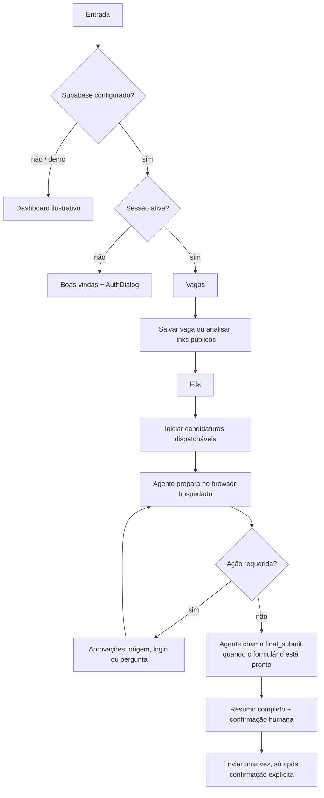

# Especificação UX/UI do NextMove

Documento de referência para reproduzir ou evoluir a tela publicada em `https://ruan-crdz.github.io/nextmove/`. O conteúdo descreve o código atual; quando um controle for apenas visual ou um fluxo estiver incompleto, isso está indicado explicitamente.

## Instruções para outra IA

- Trate este documento como contrato visual e funcional da interface existente, não como licença para criar telas ou comportamentos novos.
- Preserve Home, Vagas, Fila, Aprovações, Candidaturas e Currículo, além da marca e da linguagem em português do Brasil.
- Não copie dados pessoais da conta usada como referência. Use conteúdo fictício nos mocks.
- Não transforme ações de demonstração em operações reais, nem operações reais em aparência de sucesso.
- Não invente fatos profissionais. Currículo e respostas só podem ser usados depois de confirmação da pessoa.
- Nunca envie uma candidatura sem a ação final explícita da pessoa usuária. A aprovação de domínio, uma resposta a perguntas ou a opção **Continuar sem enviar** não autorizam o envio.
- LinkedIn é fonte pública/origem da vaga. Não adicionar scraping autenticado, OAuth privado ou Easy Apply automatizado.

## Referência e roteamento

- Implementação: React, TypeScript e Vite. A aplicação está em uma única página; as abas são controladas por estado React (`view`), não por rotas.
- `#home` é o destino do wordmark. Ele não seleciona uma aba nem define uma tela separada.
- Em uma montagem nova, a tela inicial é **Home**. Trocar de tela não muda a URL; atualizar a página volta a **Home**.
- Produção usa o base path `/nextmove/` do GitHub Pages. Links de imagem/manifest devem respeitar esse prefixo.
- Configuração Supabase + usuário deslogado: mostra a página de boas-vindas e o diálogo de autenticação.
- Supabase ausente ou `VITE_DEMO_MODE=true`: mostra o dashboard com vagas ilustrativas e faixa **DEMO** ou **PRÉVIA**. Nenhuma ação demo envia candidatura.
- Sessão Supabase válida: mostra o dashboard autenticado, carrega vagas/aplicações/matches do próprio usuário e oculta a faixa demo.

## Direção visual

- Linguagem: produto profissional, calmo e utilitário. Densidade moderada, seções alinhadas, cartões pequenos e informação fácil de comparar.
- Fontes: `Manrope` para títulos/wordmark; `DM Sans` para corpo, formulários e metadados.
- Cores globais: azul navy `#082050`, royal `#003078` / `#0060d8`, azul vivo `#0080f0`, superfícies brancas, fundo claro e texto de alto contraste; consultar `src/design-tokens.css` para os tokens ativos.
- Marca: arquivo horizontal `public/brand/nextmove-horizontal.png` nos cabeçalhos; ícone de marca nos metadados/instalação; versão empilhada em compartilhamento social.
- Cartões comuns usam borda fina, sombra discreta e raio de até 8 px. Conteúdo longo é apresentado por páginas ou etapas, sem rolagem vertical no documento.
- Ícones são Lucide. Ações principais têm texto e ícone; estados usam rótulos explícitos e sinal visual.
- Estados de foco usam outline visível. Há redução de movimento quando `prefers-reduced-motion: reduce`.

## Hierarquia da tela autenticada

Árvore lógica:

```text
App
├── Topbar fixa
│   ├── Wordmark NextMove
│   ├── Navegação: Home | Vagas | Fila | Aprovações | Candidaturas | Currículo
│   └── Estado da fila | Notificações | Conta
└── Workspace
    ├── Rail esquerdo: perfil, preferências, atalhos, privacidade
    ├── Feed central: título da aba + conteúdo da aba ativa
    └── Rail direito: fila resumida, insight demo, fontes públicas, rodapé
```

### Topbar

- Desktop: 66 px de altura, superfície branca, borda inferior, `position: sticky; top: 0; z-index: 5`.
- Wordmark à esquerda. A navegação tem seis destinos com ícone Lucide e rótulo; **Fila** exibe aplicações associadas e **Aprovações** mostra o total pendente.
- À direita: indicador verde **Fila disponível** e contador, sino de notificações e avatar.
- O avatar autenticado mostra a inicial da conta e faz sign-out ao clicar. Sem usuário, abre autenticação se Supabase estiver configurado; em demo, é apenas identificador de demo.
- O sino e **Opções de visualização** não têm ação funcional conectada no momento.

### Workspace desktop

- Largura máxima de 1296 px; alinhado ao centro, margem vertical de 25 px no topo e 56 px na base.
- Grid: `238px minmax(440px, 1fr) 272px`, intervalo de 22 px; rails alinhados ao topo.
- Rail esquerdo:
  1. Cartão de perfil com capa geométrica, avatar/letra, nome curto, rótulo **Perfil profissional**, progresso e CTA **Importar currículo**.
  2. Bloco **SUA BUSCA**. Sem usuário mostra preferências demo; com usuário mostra estado ainda não configurado. **Configurar busca** atualmente apenas informa que a configuração estará disponível em breve.
  3. **ATALHOS**: vagas salvas (abre **Candidaturas**) e atividade recente (abre **Fila**).
  4. Rodapé de privacidade e botão de ajuda, este último sem ação conectada.
- Coluna central: eyebrow **SUA BUSCA, COM MAIS CLAREZA**, título/descrição da aba e conteúdo. É a coluna principal e pode crescer sem largura fixa.
- Rail direito:
  1. **EM MOVIMENTO / Sua fila**: até três itens e link para **Fila**.
  2. Em demo/prévia sem usuário: insight ilustrativo.
  3. Cartão informativo sobre fontes públicas.
  4. Links de rodapé institucionais estáticos.

### Escala e superfícies

- Eyebrow da coluna central: caixa alta e peso 700; título principal em `Manrope` 700. Texto auxiliar mobile mantém pelo menos 12 px quando necessário para entender conteúdo ou ação.
- Cartão de vaga: superfície branca, borda `--line`, raio 7 px, sombra global, padding horizontal 16 px, gap interno de 13 px; título 16 px `Manrope` 700.
- Painel da fila: cartão branco com borda/raio 7 px e padding 16 px; na aba Fila, cartão principal usa padding 20 px.
- Modal de detalhes: desktop exibe compatibilidade e descrição; mobile separa essas seções em abas para caber na viewport sem rolagem interna.
- Modal de URL: largura `min(100%, 430px)`, padding 22 px. Modal de autenticação limita a largura a `min(100%, 410px)`.
- Backdrop dos modais: fixa na viewport, escurecimento `#20272066`, blur de 2 px e alinhamento central; clique no backdrop fecha quando o fluxo permite.

### Responsividade

- `1180 px` ou menos: o rail direito desaparece e o workspace reduz colunas.
- `768 px` ou menos: navegação inferior com cinco destinos, header compacto e workspace em uma coluna.
- As telas mantêm a viewport sem scroll vertical/horizontal; listas usam paginação, Perfil e Preferências usam etapas, e o detalhe da vaga usa abas.
- Controles mobile mantêm alvos de toque próximos de 44 px; rótulos de navegação continuam presentes e acessíveis.
- Validar larguras de 360, 375, 390, 430, 768, 1024, 1280 e 1440 px, com alturas representativas.

## Estados de navegação

### Vagas

- Título **Vagas para você**; subtítulo **Oportunidades que combinam com o que você já construiu.**
- Barra de ferramentas: campo de busca por cargo/empresa/localização, **Filtros** e seletor **Relevância**.
- A busca filtra localmente título, empresa e localidade. **Filtros** hoje só mostra um toast; **Relevância** não executa ordenação.
- Metadados mostram quantidade de oportunidades e se são da conta, prévia ou demo. **Adicionar por link** abre o modal de análise.
- Cartões em páginas dimensionadas à viewport. Controles **Anterior** e **Próxima** mantêm as demais oportunidades acessíveis; os filtros e a ordenação afetam o conjunto completo.

Cada cartão de vaga contém:

1. Marca com inicial da empresa, nome da empresa, horário textual e botão de opções (sem ação conectada).
2. Título clicável, localidade, modalidade de trabalho e faixa salarial.
3. Compatibilidade (score) e até duas competências coincidentes; sem dados, texto informa que o score depende de confirmar o perfil.
4. Uma lacuna/requisito a considerar.
5. Fonte original clicável em nova aba.
6. **Ver vaga** abre o modal de detalhes; **Adicionar à fila** salva a aplicação. Se já está na fila, mostra **Na fila**.

Modal **Detalhes da vaga**:

- Backdrop escuro, cartão central com marca da empresa e botão Fechar.
- Cabeçalho: empresa, cargo, local, modalidade, salário.
- Em mobile, abas **Compatibilidade** e **Descrição** dividem as informações para evitar rolagem interna.
- Seção **PONTOS EM COMUM**, seção **A CONSIDERAR**, descrição original, fonte e host do destino ATS permanecem disponíveis.
- Rodapé com Fechar e adicionar à fila (ou **Já está na fila**). A ação não abre o ATS.
- Clicar no backdrop fecha. Link de origem é separado do CTA da fila.

Modal **Traga uma vaga para cá**:

- Aceita até 20 URLs HTTP(S), uma por linha; duplicate URLs são deduplicadas antes da chamada.
- Em conta autenticada chama `analyze-job-links`; em modo não autenticado abre auth se Supabase estiver configurado; em demo apenas confirma recebimento sem analisar.
- Mostra estados analisando, erro e resultado, preservando origem/destino.
- Nota de segurança informa que páginas com login não são acessadas.

### Fila

- Título **Fila** e descrição **Acompanhe o trabalho do agente, etapa por etapa.**
- Resumo com total de aplicações e mensagem derivada do estado dominante: precisa de resposta, falha, agente ativo, fila aguardando ou regra de confirmação final.
- Linhas clicáveis mostram inicial, cargo, empresa/local, status e seta; clicar abre detalhes da vaga.
- Status renderizados: **Salva**, **Aguardando na fila**, **Agente trabalhando**, **Precisa de você**, **Falhou**, **Cancelada**. Runs failed mostram `failure_reason` em texto menor. Um status submitted não tem rótulo dedicado consistente no render atual; não reproduzir como comportamento desejado.
- Bloco **Você mantém o controle** reforça que dados sensíveis/revisão e envio final dependem da pessoa.
- CTA **Iniciar N candidaturas** inicia apenas itens dispatcháveis. Exclui applying, needs_input, submitted, failed e cancelled. Em demo, mostra aviso e não envia.
- A fila enfileira via `queue-application` e inicia via `dispatch-application`; a interface não abre o ATS diretamente.
- Mini-fila do rail direito mostra empresa, progresso decorativo e estado. A barra de progresso não representa percentual real do formulário.

### Aprovações

- Lista autenticada paginada; atualiza a cada 8 segundos consultando `application-status`.
- Badge no menu é contagem de solicitações pendentes. Vazio mostra escudo e **Nenhuma aprovação pendente**.
- Cartão inclui cargo/empresa, tipo de pedido, classificação de risco, pergunta, domínio/motivo e campos relevantes.
- Tipos previstos: pergunta/ausência de informação, acesso a novo domínio, autenticação do browser, revisão final legada e autorização explícita de envio.
- Acesso a domínio: mostrar domínio e motivo; **Permitir uma vez** é a decisão humana de abrir aquela origem. Não confundir com permissão de submissão.
- Autenticação: campos são gerados a partir da solicitação do browser; senhas/códigos usam input mascarado e são enviados pela ação específica `browser_authentication`, não por mensagens normais nem por storage do app.
- Perguntas: responder em textarea e continuar a mesma sessão; sugestões são indicadas como baseadas no currículo revisado.
- Pedido `final_submit`: mostrar resumo antes do CTA **Confirmar e enviar candidatura**. Só esse CTA autoriza o envio; `auto_submit=false` permanece obrigatório.
- Mensagens de loading, erro e confirmação aparecem na própria tela. Botão de negar/cancelar não deve ser tratado como envio.
- Sessão `idle` não prova sucesso. O caminho normal de finalização é o agente chamar `request_user_response` com `request_type: final_submit`; não fabricar uma aprovação final genérica.

### Candidaturas

- Lista paginada de vagas salvas com cargo, empresa/localização e status atual. Selecionar uma linha abre os detalhes da vaga.
- Quando vazia, exibe orientação e CTA **Explorar vagas**.

### Currículo

- Cabeçalho **Importar currículo**, botão Voltar e mensagem de consentimento: dados só entram no perfil após revisão e confirmação.
- Abas **Currículo** e **LinkedIn** separam upload e perfil público. A URL do LinkedIn normaliza `/in/` ou `/pub/`; não acessa conteúdo privado.
- Upload aceita PDF/DOCX de até 10 MB para o bucket privado. Mostra nome/tamanho selecionado, extração carregando, erro e estado de revisão.
- `parse-resume` cria perfil estruturado como rascunho. A pessoa revisa em etapas: Dados, Resumo, Experiência, Formação e Extras; registros repetidos também são paginados.
- A pessoa edita dados básicos, resumo, competências, experiências (incluindo cargo atual), formação, idiomas, certificações e projetos/tecnologias.
- Seções vazias mostram que nenhum item foi identificado. Email da conta é somente leitura.
- CTA **Confirmar perfil e buscar vagas** persiste perfil/evidências/versão de currículo confirmados e então dispara busca pública de vagas no LinkedIn; após salvar, mostra **Perfil confirmado**.
- A confirmação do currículo não autoriza enviar candidatura.

## Entrada institucional e autenticação

Quando Supabase está configurado e não há sessão, `WelcomePage` substitui o dashboard:

- Navbar branca (70 px desktop) com logo e **Entrar**.
- Vista inicial com apresentação do produto e prévia da interface; **Como funciona** e **Segurança** são vistas acessíveis pela navegação.
- A landing cabe na viewport em desktop e mobile, sem rolagem vertical; CTAs de cadastro e entrada permanecem disponíveis.

`AuthDialog` é modal central com email, senha (mínimo 8), CTA Criar conta/Entrar e alternância entre cadastro/login. Cadastro sem sessão informa que a conta foi criada e que a pessoa deve entrar. Não há login social, recuperação de senha ou OAuth LinkedIn no componente atual.

## Fluxos e estados



Status normalizados em `src/domain/jobs.ts`: `saved`, `queued`, `applying`, `needs_input`, `submitted`, `failed`, `cancelled`. `researching` e `preparing` aparecem como `applying`. O indicador superior **Fila disponível** não mede atividade individual do agente.

## Estados visuais a preservar

- Auth loading: boas-vindas pode mostrar **Carregando sua sessão…**; evitar renderizar cadastro temporário.
- Busca/análise: CTA desabilitado, texto de progresso e spinner/texto no toast.
- Currículo: sem arquivo, arquivo escolhido, upload/extrator carregando, revisão editável, erro, salvando, salvo.
- Vagas: lista, nenhum resultado, score indisponível, na fila, modal de detalhes.
- Fila: vazia, salvas, aguardando, aplicando, precisa de você, falha com motivo, cancelada.
- Aprovações: vazia, domínio, login, pergunta, final submit; botão ocupado e mensagem de erro/sucesso.
- Toast global no canto inferior; mensagens de status usam `role="status"` onde implementado.

## Limites funcionais atuais

- Filtros e ordenação atuam no conjunto de vagas; preferências são editáveis por etapas quando há sessão autenticada.
- Candidaturas são acompanháveis na lista paginada; não representar o status da fila como envio concluído.
- O demo usa fixtures e score ilustrativo; nunca misturar com dados reais.
- O app instalável usa manifest e ícones, mas não há service worker/offline.
- Paginação e etapas substituem listas ou formulários extensos; não reintroduzir scroll vertical global ou interno nas telas descritas.
- Browser do agente é isolado e hospedado; nenhum envio automático. Aprovação de domínio e finalização são decisões distintas.

## Acessibilidade e comportamento

- Usar headings na ordem semântica, links para navegação externa, botões para ações, labels para formulário e `aria-label` em botões só de ícone.
- Modais usam `role="dialog"`, `aria-modal="true"` e `aria-labelledby`; fechar por backdrop quando explicitamente permitido.
- Não remover outlines de foco. Inputs mantêm label visível; estado desabilitado/loading é perceptível.
- Em mobile, a navegação inferior mantém ícones e rótulos visíveis; o destino atual usa `aria-current`.
- Interação de fila e aprovação precisa refletir resposta real do backend; não converter `queued` em “Agente trabalhando”, nem `idle` em candidatura enviada.

## Fontes no repositório

- Estrutura e callbacks: [`src/App.tsx`](../src/App.tsx)
- Landing: [`src/components/WelcomePage.tsx`](../src/components/WelcomePage.tsx)
- Currículo: [`src/components/ResumeImportView.tsx`](../src/components/ResumeImportView.tsx)
- Aprovações: [`src/components/ApprovalQueueView.tsx`](../src/components/ApprovalQueueView.tsx)
- Estados de vaga: [`src/domain/jobs.ts`](../src/domain/jobs.ts)
- Estilos principais: [`src/styles.css`](../src/styles.css)
- Estilos de landing/mobile: [`src/components/welcome.css`](../src/components/welcome.css) e [`src/components/welcome-mobile.css`](../src/components/welcome-mobile.css)
- Metadados PWA/brand: [`index.html`](../index.html) e [`public/manifest.webmanifest`](../public/manifest.webmanifest)